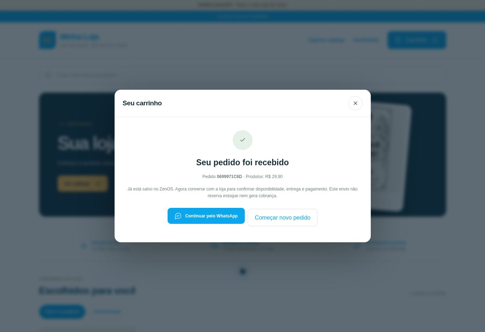

# Commerce Premium — auditoria e primeira correção isolada (18/10/2026)

**Não é uma liberação final. Sem merge/deploy em produção.**

## Base verificada no GitHub

- main: `7e565ea27c7d8dd02f03c774e8cc20e10ed5124a` (PR #45 integrado).
- #44: integrado, merge `ba7c28e91f5d77195c96a17da9dfaa879e68c1f4`.
- #30: aberto/draft, `44fd4f3c1cb630c21793ee673ecd6af2fe0d1e15`; não mergeável na consulta.
- #46: aberto/draft, `57d9fb029e90e3b6f1ea779ca8121eee89c75229`, baseado no #30.
- #47: aberto/draft, `ea7aa1fab5688aac139648a87c7b3c20e9013749`, baseado no #46.
- Branch desta revisão parte do #47 e incorpora main sem alterar seu histórico. Conflito único em App.jsx resolvido mantendo o Portal Commerce e a prop `recarregarDadosPDV` do #44. Não remover gates do #45.

## Estado encontrado

| Frente | Classificação | Evidência / limite |
|---|---|---|
| Rascunho, licença, galeria 8 fotos, preços online e descrição web | Implementado, validação parcial | Backend, Studio e testes existentes. Navegador autenticado não validado nesta revisão. |
| Banner | Implementado, não aprovado na nuvem | Há upload/path privado/hidratação no código. Loja publicada mostrou composição padrão, sem foto de banner identificável. Upload/reabertura/publicação real da versão atual ainda obrigatórios. |
| Checkout simples | Um cenário real fictício validado | Loja fixa confirmou `0699971C6D`, R$29,90, 1 produto. Não prova resolução do travamento original. |
| Carrinho | Parcial; correção desta revisão | Persistia quantidades/chave, mas não recuperava confirmação perdida após reload. Nova consulta privada de envio e trava síncrona. |
| Aba online por produto | Implementado, não homologado ponta a ponta | Reaproveita Studio/Portal; protegido por flag. Falta validar save/reopen, autorização real, operadores e concorrência. |
| Prévia fiel | Parcial | Editor possui renderização própria; não é a mesma vitrine pública. Deve convergir para o mesmo componente/projeção. |
| Notificações | Parcial | Poll de últimos 50 pedidos a cada 90s apenas com Portal aberto/aba visível. Não é notificação global no ZenOS. |
| PDV | Pendente | Sem importação, trava transacional ou vínculo pedido→venda. Não criar botão antes desses controles. |
| Entrega | Parcial | Apenas texto livre. Faltam seleção entrega/retirada, endereço e regras/taxas de região validadas no servidor. |
| Identidade institucional | Parcial | Nome/slogan existem; faltam logo, redes, endereço opcional, horários e políticas completos. |
| PDF/imagem de pedido | Pendente | Share V2 existente preservado; não há comprovante Commerce integrado validado. |
| Ativação/servidor | Implementado para homologação | Licença e ACL privadas; guardas de ambiente bloqueiam produção. Não equivale a módulo pronto para ativação em produção. |

## Bloqueios técnicos antes da liberação

1. **Fonte canônica V1/V2:** `commerceOrders.js` e `commerceMedia.js` leem diretamente `dados/operacao`. Não usam `storage_control`/geração V2. Após cutover V2, preço/estoque/cadastro V1 podem estar antigos. Implementar adaptador SOMENTE DE LEITURA certificado, com leitura consistente na transação de checkout e sem fallback silencioso. Testar tombstones, cutover, manutenção e concorrência. Nenhuma alteração V1/V2 operacional feita nesta revisão.
2. **Autenticação:** ZenOS usa identidade Firebase do estabelecimento e seleção local de operador/PIN. Commerce exige UID individual verificado + `commerce_operator_access`, admin e UID diferente da loja. Aceitar apenas o papel enviado pelo navegador seria vulnerável. Não retirar segunda entrada sem desenho de identidade de operador validado no servidor. Conferir regras reais/provisionamento antes de modificar esse contrato.
3. **Homologação operacional:** build com SDK cloud-hml é roteado sempre ao componente isolado em main.jsx, não ao App operacional. Bom isolamento, mas insuficiente para testar fluxo integrado com PDV. Preparar modo operacional HML explicitamente cercado, produtos/clientes fictícios e Auth local ao projeto de teste. Nunca permitir fallback para `zenos-ac6b2`.
4. **Escala:** rascunho inteiro limitado a 110.000 caracteres, regras até 3.000 produtos mas apenas 256 fotos extras/loja. Publicação duplica regras em documento único, hidrata todas as URLs e retorna catálogo integral; editor mostra só 50 produtos filtrados. Precisa documentos de configuração individualizados, projeção pública paginada e carregamento de galeria por produto. Sem migração destrutiva; introduzir esquema versionado e manter leitura compatível. Não apenas aumentar limites.
5. **PDV:** importação deve carregar rascunho separado, revalidar IDs/preços/estoque, impedir sobrescrita e faturamento concorrente. Pedido só vira venda concluída com vínculo confirmado na mesma fronteira transacional da venda. Uma marcação posterior isolada não impede venda dupla. Não duplicar motores financeiros existentes.
6. **Antia­buso:** quotas existentes (500 pedidos/loja/dia, 10/comprador/dia) e maxInstances não são teto financeiro. Validar App Check/limitação de chamadas públicas e mídia órfã antes da produção, sem contratar fornecedor.
7. **Segurança real:** regras cloud HML deny-all + callables diferem da aplicação operacional. Auditar regras de produção e correspondências sobrepostas antes da integração; não publicar regras de emulador.

## Correção de recuperação do checkout desta revisão

- Antes da requisição, persiste somente SKU/quantidade/chave/estado, sem nome, telefone ou observações do consumidor.
- Erro/timeout conserva envio pendente e bloqueia editar/reconfirmar até consulta autoritativa.
- `consultarPedido` usa identidade Firebase anônima original + chave + loja pública; não aceita ID arbitrário de pedido, nem expõe dados pessoais.
- Reabertura recupera número e confirmação; consulta não cria pedido e funciona mesmo após despublicação da loja.
- Ausência de identidade original não inicia outro usuário anônimo durante recuperação.
- Guarda síncrona impede duplo clique; prazo devolve controle à interface sem afirmar cancelamento remoto.
- Sem venda, baixa de estoque, caixa, comissão ou alteração operacional. Nenhuma dependência de aplicação nova.

## Evidência real obtida

URL: https://zenos-commerce-homologacao.web.app/loja/zc-6z4dnkqmaz3qwj

A interface existente confirmou um pedido fictício com observação explícita de teste/não atender. Link WhatsApp apenas inspecionado; nenhuma mensagem enviada. Confirmação observada no navegador, não conferida na fila privada por ausência de autenticação administrativa.

A captura refere-se à versão já publicada, não ao código novo desta branch.

## Acesso e publicação

Firebase CLI desta sessão: **nenhuma conta autorizada** (`firebase login:list`). Sem deploy novo nem alteração IAM/domínios. Próximo acesso necessário: conta autorizada somente para `zenos-commerce-homologacao`, para verificar Auth/domínio fixo, versão das funções e logs e implantar alteração isolada após testes. Não pedir senha/código no chat.

## Custos e rollback

Sem fornecedor, projeto ou dependência de runtime novos; sem cobrança automática. Consulta de recuperação acrescenta 2–3 leituras somente quando necessária, não polling contínuo. Novos testes usam emuladores locais/CI existente. Sem migração e sem modificação de dados operacionais. Rollback do código: reverter o commit de recuperação e republicar somente funções/site HML; pedidos já salvos permanecem no formato existente. A incorporação de main preserva #44/#45 e não deve ser revertida como forma de retirar o Commerce.

## Sequência de continuação

1. Validar recuperação em emuladores/UI e nuvem isolada; diagnosticar banner/logs autenticados.
2. Resolver leitura canônica V1/V2 e isolamento de homologação operacional.
3. Aprovar contrato seguro para reaproveitamento da sessão e permissões dos operadores.
4. Individualizar configuração/paginação e completar quatro áreas administrativas, usando a própria vitrine como prévia.
5. Entrega/checkout → notificação global → atendimento → importação e conclusão transacional no PDV → documentos via Share V2.
6. Homologar todos os botões, desktop/mobile, falhas, duas lojas e dois operadores. Só solicitar liberação final com evidências completas e gates aprovados.
