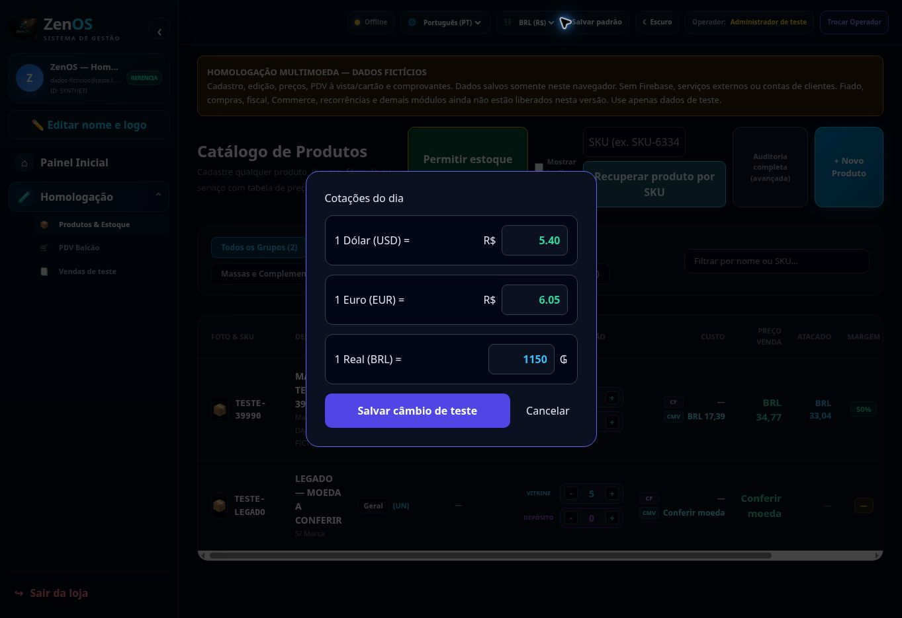

# Homologação publicada para teste

URL verificada no navegador: https://zen-5oohtjssn-itamarpassos995-4355.vercel.app/

Commit do código publicado: `3e0062067ef9c8da68f737c125cffffdd64697f8`. Deployment Vercel `dpl_Bp9hT4q7PoungwKoynwxNNAzJX4S`, READY, preview sem promoção ao domínio oficial.

Parâmetros iguais aos prints do cliente: **1 USD = BRL 5,40; 1 EUR = BRL 6,05; 1 BRL = PYG 1.150**. A entrada do operador é separada da normalização interna. Gs. 39.990 devem equivaler a R$ 34,77. A taxa de fixture 230 e a janela anterior com sentido diferente não validavam os parâmetros reais do cliente.

Validação: 29 testes Node e 3 de interface novos aprovados. A regressão de interface confirma salvar os parâmetros, exibir BRL 34,77, voltar a PYG 39.990 e preservar o preço original. O preview remoto também foi aberto e esses valores e os três campos foram conferidos.

Produtos/PDV usam dados fictícios locais, sem Firebase ou APIs. Os demais módulos da arquitetura integral continuam pendentes; não usar contas reais. Roteiro e limites: [TESTE_MANUAL.md](TESTE_MANUAL.md).

