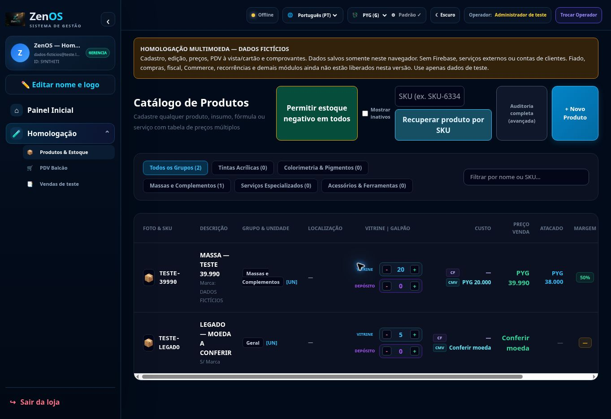

# Homologação publicada para teste

URL verificada no navegador: https://zen-n600n1h89-itamarpassos995-4355.vercel.app/

Commit do código publicado: `85038121f58cc18b0b30c9ecced51de6b3166b43`. Deployment Vercel `dpl_HuRC8ctbhvgnxqtvo1qSRX3b5Re2`, READY, preview sem promoção ao domínio oficial.

Reutiliza Produtos e PDV existentes com dados fictícios locais, sem Firebase ou APIs. Cobre cadastro/edição, preferência, equivalências, venda à vista/cartão, estoque e comprovantes. Não homologa os demais módulos da arquitetura integral. Roteiro e limitações em [TESTE_MANUAL.md](TESTE_MANUAL.md).

Validação: 26 testes Node e 2 de interface novos aprovados; suíte de regressão existente aprovada. A conferência no navegador incluiu o ciclo PYG 39.990 → BRL 173,87 → PYG 39.990, salvar/recarregar e venda fictícia com comprovante. O preview final também foi aberto e conferido após os ajustes de apresentação do checkout.

